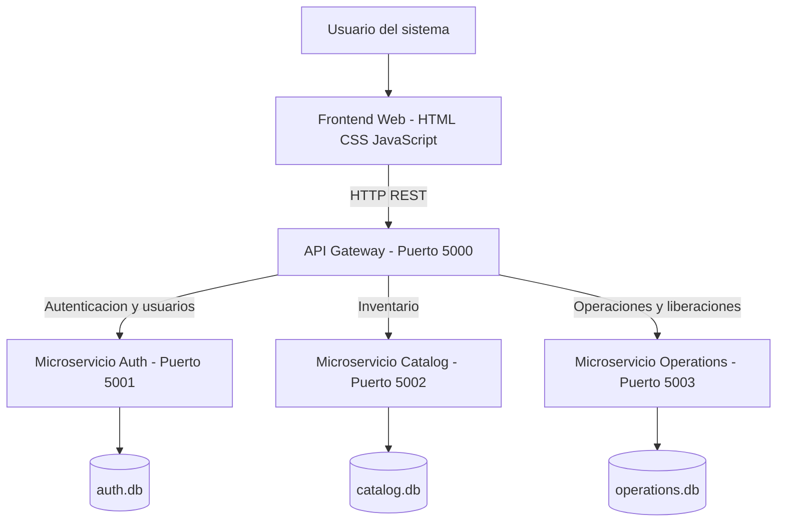

# Diagrama de Arquitectura
## Sistema de Gestion de Logistica Portuaria

El sistema utiliza una arquitectura de microservicios. El frontend se comunica exclusivamente con el API Gateway, que distribuye las solicitudes a los servicios correspondientes.

## Componentes

| Componente | Puerto | Responsabilidad |
|---|---:|---|
| Frontend | Navegador web | Interfaz de usuario |
| API Gateway | 5000 | Entrada y distribucion de solicitudes |
| Auth | 5001 | Usuarios, autenticacion y roles |
| Catalog | 5002 | Inventario portuario |
| Operations | 5003 | Operaciones y liberaciones |

## Flujo de comunicacion

1. El usuario interactua con el frontend.
2. El frontend envia solicitudes HTTP al API Gateway.
3. El Gateway valida la autenticacion y los permisos correspondientes.
4. El Gateway envia cada solicitud al microservicio correspondiente.
5. Cada microservicio consulta o modifica su propia base de datos.
6. La respuesta regresa al frontend a traves del Gateway.

## Independencia de los servicios

Auth, Catalog y Operations tienen bases de datos independientes. Esta separacion permite que cada servicio administre sus propios datos.

El API Gateway funciona como intermediario y no necesita una base de datos propia.
